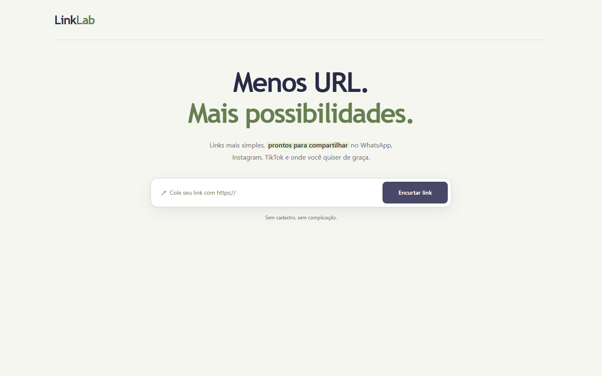
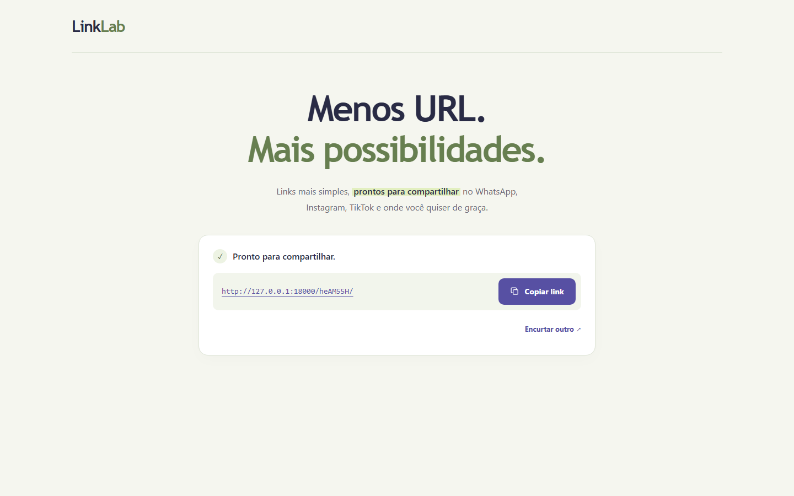
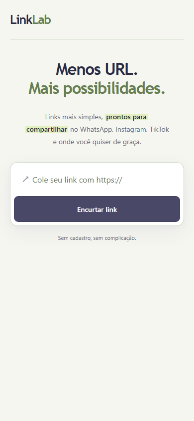

# LinkLab

**Menos URL. Mais possibilidades.** Um encurtador de URLs Full Stack com React e Django REST Framework, desenvolvido como projeto de portfólio para demonstrar integração de APIs REST, persistência SQL e testes automatizados.

O projeto funciona localmente. Não existe uma instância pública hospedada: os links gerados dependem do servidor local e do banco em que foram criados.



## Funcionalidades

- Criação de links com códigos aleatórios de sete caracteres usando `secrets`.
- Validação de endereços HTTP/HTTPS de até 2.048 caracteres; esquemas perigosos e URLs com credenciais são rejeitados.
- Unicidade no banco, novas tentativas em colisões e proteção de nomes reservados.
- Redirecionamento HTTP 302 e incremento atômico de acessos com `F()`.
- Estatísticas com URL original, código, data de criação e quantidade de acessos, disponíveis pela API.
- Interface responsiva em índigo e verde-sálvia, com carregamento, mensagens de erro e foco em criar e copiar links.
- O resultado substitui o formulário, com confirmação de cópia e opção de encurtar outro link.
- Labels, foco visível, navegação por teclado e mensagens acessíveis.
- Limites básicos por IP: 20 criações/minuto e 120 consultas de estatísticas/minuto.
- SQLite na execução local; PostgreSQL com volume persistente no Docker Compose.

## Tecnologias e arquitetura

| Camada | Tecnologias |
| --- | --- |
| Backend | Python 3.14, Django 6.1.2, Django REST Framework 3.18.3 |
| Frontend | React 19, JavaScript/JSX, Vite 8, CSS |
| Banco de dados | SQLite; PostgreSQL 17 no Compose |
| Verificação | Django Test Runner, Node Test Runner, Oxlint, GitHub Actions |

```text
Navegador → React / Vite :5173 → proxy /api → Django :8000 → SQLite ou PostgreSQL
Navegador → Django /{codigo}/ → HTTP 302 → URL original
```

O navegador acessa `/api` pela origem do frontend; o proxy encaminha a chamada ao backend. O link curto aponta diretamente para a origem do Django. O serializer centraliza a representação usada na criação e nas estatísticas. O contador é atualizado no banco, sem leitura e escrita do valor em Python.

```text
linklab/
├── backend/
│   ├── config/                 # Settings e rotas Django
│   ├── links/                  # Modelo, API, throttles, migrações e testes
│   ├── manage.py
│   ├── requirements.txt
│   ├── requirements-docker.txt
│   └── Dockerfile
├── frontend/
│   ├── src/                    # Interface, cliente da API e testes
│   ├── public/
│   ├── .env.example
│   ├── package.json
│   ├── package-lock.json
│   ├── vite.config.js
│   └── Dockerfile
├── scripts/smoke_test.py        # Integração real Django + proxy Vite
├── docs/VALIDACAO.md
├── .github/workflows/ci.yml
├── .env.example
├── .gitignore
└── compose.yaml
```

## Requisitos

- Python 3.14 com pip; o ambiente de desenvolvimento foi verificado com Python 3.14.8.
- Node.js 24 e npm; verificados com Node 24.22.0 e npm 11.19.1.
- Git para clonar e versionar.
- Opcional: Docker com Compose v2 para executar com PostgreSQL.

As dependências Python diretas estão fixadas em `backend/requirements.txt`. O lockfile do npm registra as versões exatas do frontend; use `npm ci` para reproduzi-las. Não é necessário instalar um servidor PostgreSQL para a execução com SQLite.

## Execução local no Windows / PowerShell

Após obter o projeto, abra dois terminais na pasta `linklab`.

**Terminal 1 — backend:**

```powershell
cd backend
python -m venv .venv
.\.venv\Scripts\python.exe -m pip install -r requirements.txt
.\.venv\Scripts\python.exe manage.py migrate
.\.venv\Scripts\python.exe manage.py runserver 127.0.0.1:8000
```

Se `.venv` já existir, reutilize-o e execute a partir da instalação das dependências. Caso o Windows use `py` como launcher, substitua o primeiro `python` por `py -3.14`. Não é necessário ativar o ambiente virtual nem mudar a política de execução do PowerShell.

**Terminal 2 — frontend:**

```powershell
cd frontend
npm.cmd ci
npm.cmd run dev
```

Abra **http://localhost:5173**. Mantenha os dois terminais ativos. Os links curtos apontam normalmente para **http://127.0.0.1:8000/{codigo}/**. O SQLite é criado em `backend/db.sqlite3` e não deve ser versionado.

No Linux/macOS, crie o ambiente com `python3 -m venv .venv`, use `.venv/bin/python` nos comandos do backend e `npm` nos comandos do frontend.

## Configuração

O backend lê variáveis de ambiente do processo. Ele **não carrega arquivos `.env` automaticamente**. Os valores padrão permitem executar com SQLite sem criar arquivos de configuração. No PowerShell, defina variáveis antes de iniciar o servidor, por exemplo:

```powershell
$env:DJANGO_DEBUG = 'true'
$env:DJANGO_ALLOWED_HOSTS = 'localhost,127.0.0.1,[::1]'
$env:SHORT_URL_BASE = 'http://127.0.0.1:8000'
```

| Variável do backend | Padrão / uso |
| --- | --- |
| `DJANGO_DEBUG` | `true`; use `false` somente com configuração própria para implantação |
| `DJANGO_SECRET_KEY` | Chave temporária gerada em desenvolvimento; obrigatória com DEBUG desativado |
| `DJANGO_ALLOWED_HOSTS` | `localhost,127.0.0.1,[::1]`; lista separada por vírgulas |
| `SHORT_URL_BASE` | Se ausente, usa a origem da requisição; no Docker usa `http://localhost:8000` |
| `SQLITE_PATH` | Caminho alternativo para SQLite; usado no teste de integração |
| `POSTGRES_HOST` | Quando definido, seleciona PostgreSQL em vez de SQLite |
| `POSTGRES_PORT` | `5432` |
| `POSTGRES_DB` / `POSTGRES_USER` | `linklab` |
| `POSTGRES_PASSWORD` | Obrigatória ao selecionar PostgreSQL |

Para usar PostgreSQL fora do Docker, instale também `backend/requirements-docker.txt` e defina as variáveis `POSTGRES_*` antes de executar as migrações. Os bancos SQLite e PostgreSQL são independentes; os dados não são transferidos automaticamente.

O Vite lê `frontend/.env` automaticamente:

```powershell
cd frontend
Copy-Item .env.example .env
```

| Variável do frontend | Uso |
| --- | --- |
| `API_PROXY_TARGET` | Destino do proxy em desenvolvimento e preview; padrão `http://127.0.0.1:8000` |
| `VITE_API_BASE_URL` | Prefixo público da API; padrão `/api`; aplicado na construção do bundle |

Reinicie o Vite após alterar sua configuração. Nunca coloque segredos em variáveis `VITE_`: elas ficam acessíveis no navegador. Para servir o bundle em outra infraestrutura, encaminhe `/api` para Django na mesma origem. Uma API em origem diferente exige configuração explícita de CORS, que não faz parte desta execução local.

## Docker Compose com PostgreSQL

O Compose é uma alternativa **para execução local**, usando `runserver` do Django e `vite preview`. Esses servidores não configuram uma implantação pública de produção.

Na raiz:

```powershell
Copy-Item .env.example .env
```

Edite `.env` e substitua `POSTGRES_PASSWORD` e `DJANGO_SECRET_KEY` pelos seus valores locais. Para gerar uma chave, caso Python esteja disponível:

```powershell
python -c "import secrets; print(secrets.token_urlsafe(50))"
```

Depois:

```powershell
docker compose up --build
```

Abra **http://localhost:5173**. As migrações são aplicadas ao iniciar o backend. As portas ficam vinculadas a `127.0.0.1`, e o banco não publica porta no host.

```powershell
docker compose logs backend
docker compose exec backend python manage.py test
docker compose exec frontend npm test
docker compose down
```

O comando `down` preserva os dados no volume `postgres_data`. **`docker compose down -v` apaga esse volume e os dados PostgreSQL.** Alterar a senha em `.env` não muda a senha de um banco já inicializado; não remova o volume para resolver isso se houver dados que deseja preservar.

A configuração Docker foi preparada, mas ainda requer execução em uma máquina com Docker. Consulte o registro de validação antes de considerar essa etapa verificada.

## API

### Criar um link

`POST /api/links/`

```json
{ "original_url": "https://example.com/artigos?categoria=python" }
```

Resposta `201 Created` (código e data são ilustrativos):

```json
{
  "id": 1,
  "original_url": "https://example.com/artigos?categoria=python",
  "short_code": "Lk7aB2x",
  "created_at": "2026-10-15T15:00:00Z",
  "click_count": 0,
  "short_url": "http://127.0.0.1:8000/Lk7aB2x/"
}
```

Exemplo no PowerShell:

```powershell
$body = @{ original_url = 'https://example.com/artigos?categoria=python' } | ConvertTo-Json
$link = Invoke-RestMethod -Method Post -Uri 'http://127.0.0.1:8000/api/links/' -ContentType 'application/json' -Body $body
$link
Invoke-RestMethod "http://127.0.0.1:8000/api/links/$($link.short_code)/stats/"
```

### Redirecionar

`GET /{short_code}/` retorna `302 Found`, com o destino em `Location`, e incrementa o contador. A resposta usa `Cache-Control: no-store` para evitar que o cache do redirecionamento prejudique a contagem. `HEAD` retorna os cabeçalhos sem incrementar. Outros métodos retornam `405`.

### Consultar estatísticas

`GET /api/links/{short_code}/stats/` retorna `200 OK` com os mesmos campos da criação e o contador atualizado. Essa consulta não conta como acesso.

| Situação | Resposta |
| --- | --- |
| URL inválida, ausente ou esquema não permitido | `400`, com erro em `original_url` |
| Código inexistente | `404` |
| Método não permitido | `405` |
| Limite de requisições atingido | `429`, com `Retry-After` |
| Cinco tentativas sem obter código disponível | `503`, com `detail` |

Os endpoints `/api/` usam JSON; o 404 de um redirecionamento usa a resposta padrão do Django. IDs, códigos, datas e contadores são somente leitura para o cliente. Cada criação produz um novo link, mesmo para um destino repetido.

## Testes e verificações

Na raiz, com as dependências instaladas:

```powershell
.\backend\.venv\Scripts\python.exe -m pip check
.\backend\.venv\Scripts\python.exe backend/manage.py check
.\backend\.venv\Scripts\python.exe backend/manage.py makemigrations --check --dry-run
.\backend\.venv\Scripts\python.exe backend/manage.py test links
.\backend\.venv\Scripts\python.exe scripts/smoke_test.py
```

O teste de integração inicia servidores temporários nas portas **18000** e **15173**, verifica página, proxy, criação, redirecionamento e estatísticas, e encerra os processos. Ele usa um SQLite temporário em `test-results/`; não altera seu banco local nem acessa o destino externo do link. Mantenha essas portas livres.

No frontend:

```powershell
cd frontend
npm.cmd test
npm.cmd run lint
npm.cmd run build
```

Os testes Python cobrem criação, validação, campos somente leitura, geração, códigos reservados, colisões, erros, redirecionamento, contagem e limites de requisições. O teste de acessos simultâneos roda somente com PostgreSQL; com SQLite ele é explicitamente ignorado. Os nove testes JavaScript verificam o cliente da API com respostas simuladas, inclusive falhas de rede, JSON inválido e limite de requisições. Eles não testam cliques ou layout no navegador.

O workflow `.github/workflows/ci.yml` prepara testes com SQLite e PostgreSQL, lint e build do frontend a cada push e pull request. Ele só será executado no GitHub após a publicação autorizada.

Resultados da validação e roteiro de revisão manual: [docs/VALIDACAO.md](docs/VALIDACAO.md).

## Limitações conhecidas

- Sem hospedagem pública: links `localhost` não funcionam como links públicos nem apontam para seu computador quando abertos em outro dispositivo.
- URLs que já são pequenas podem gerar um link maior, pois o endereço final inclui a origem local, a porta e o código.
- O contador mede requisições GET recebidas, incluindo visitas repetidas e bots; não representa pessoas únicas.
- O throttle usa cache em memória por processo, reinicia com o servidor e não garante um limite estrito sob concorrência. Pelo proxy Vite, os clientes compartilham o IP do proxy. Os redirecionamentos não são limitados.
- SQLite pode bloquear escritas simultâneas; para explorar concorrência, use PostgreSQL.
- As estatísticas são públicas para quem conhece o código. Não armazene URLs com informações sensíveis; parâmetros de consulta podem conter dados privados.
- Não há verificação de reputação ou disponibilidade dos destinos. O backend valida o endereço, mas não o visita. Um endereço válido pode apontar para conteúdo inseguro.
- Não há expiração, exclusão ou lista de links na interface.
- A cópia depende da Clipboard API; se falhar, a interface orienta a copiar manualmente.
- A chave temporária de desenvolvimento muda ao reiniciar o processo; sessões administrativas podem ser invalidadas. Configure uma chave estável se precisar delas.
- Docker, PostgreSQL e o resultado do CI no GitHub ainda precisam de validação. As capturas e o fluxo de criação/reinício foram conferidos no Chrome; a revisão manual completa de teclado, cópia e dispositivos reais continua pendente.

## Capturas de tela

Capturas reais do Chrome com a aplicação executando localmente, usando um banco temporário e uma URL de exemplo. As imagens de desktop têm resolução de 1.440 × 900; a versão de celular foi capturada em uma viewport de 390 × 844.

**Resultado de um link criado:**



**Interface em tela de celular:**



## Melhorias futuras

- Testes de componentes e fluxos de navegador em desktop e celular.
- Expiração e exclusão de links, conforme a necessidade do projeto.
- Verificação de reputação e proteção adicional contra abuso antes de uma eventual hospedagem pública.
- Configuração de implantação com HTTPS, servidor de aplicação e cache compartilhado, se houver necessidade real.

## Licença

**Pendente de confirmação da autora. Nenhuma licença foi aplicada.** A MIT é uma opção permissiva comum para portfólios: permite uso, modificação e distribuição, preservando o aviso de autoria e o texto da licença, com exclusão de garantias. A escolha precisa ser confirmada antes de criar `LICENSE`. Publicar o código sem licença não concede automaticamente uma licença open source.

Referência para avaliar o texto: [MIT License — Open Source Initiative](https://opensource.org/license/mit).

## Preparação para publicar no GitHub

1. Revise os arquivos e os resultados em `docs/VALIDACAO.md`.
2. Execute o Compose e revise o layout e a navegação no navegador.
3. Confirme a licença desejada e acrescente `LICENSE` se decidir licenciar.
4. Confira `git status --short --untracked-files=all` e `git status --short --ignored`. `.env`, `.venv`, bancos, `node_modules`, caches e builds não devem entrar no repositório; os dois `.env.example` e o lockfile devem entrar.
5. Revise cuidadosamente os arquivos antes de criar o primeiro commit. Nunca publique seu banco local ou URLs privadas.
6. Após sua aprovação, crie um repositório vazio no GitHub, faça o commit local, configure o remoto e envie a branch. Não há comandos de publicação executados automaticamente neste projeto.
7. Confira o resultado do GitHub Actions antes de divulgar o portfólio.
